# Atlas of maps produced so far

Prepared 17 October 2026. Twelve existing analytical map plates, reproduced without changing their values or classifications.

[Download the PDF atlas](../../output/pdf/Berlin_Map_Atlas_October_2026.pdf) · [Machine-readable catalogue](catalogue.csv) · [Interactive LOR map](../../output/spatial/maps/lor_watering_interactive.html)

The PDF uses large pages to preserve small-multiple maps; zoom for labels or open the original PNG. For each plate, the source table and builder are linked below. Geometry is analysed in EPSG:25833; the web map displays EPSG:4326. LOR geometry: Amt für Statistik Berlin-Brandenburg, CC BY 3.0 DE. See [source attribution](../../data/spatial/README.md) and the [tree inventory note](../../data/raw/tree_inventory/README.md).

The atlas covers saved analytical maps in `output/`. Earlier slide-only colour mockups and duplicated presentation images are not separate analytical results. Supporting charts remain in the [results guide](../preliminary_results.md). Cooling-loss maps, daily response slopes with uncertainty, and allocation rankings are planned.

## Plate 01 — District spatial baseline

**Period:** 2025 LST and tree cover; May 2020-Dec 2025 watering. **Measure:** Legacy district LST and canopy context; watering reach (%) and litres per inventory tree.

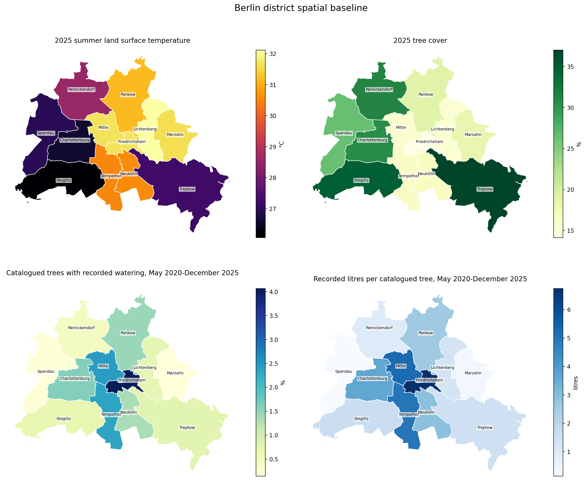

[Original PNG](../../output/spatial/figures/01_district_spatial_baseline.png) · [Data table](../../output/spatial/tables/lor_watering_metrics_2020_2025.csv) · [Builder](../../analysis/build_spatial_notebook.py)

LOR metrics are aggregated by district and joined to the 2025 summer rows of data/Berlin_heat_population_death_Birth_data.csv. Reference periods differ; legacy heat provenance is incomplete. Recorded platform activity only; current-inventory denominators; no inference about unlogged or municipal watering.

## Plate 02 — Neighbourhood watering reach and intensity

**Period:** May 2020-Dec 2025. **Measure:** Distinct-tree reach (%) and recorded litres per inventory tree.

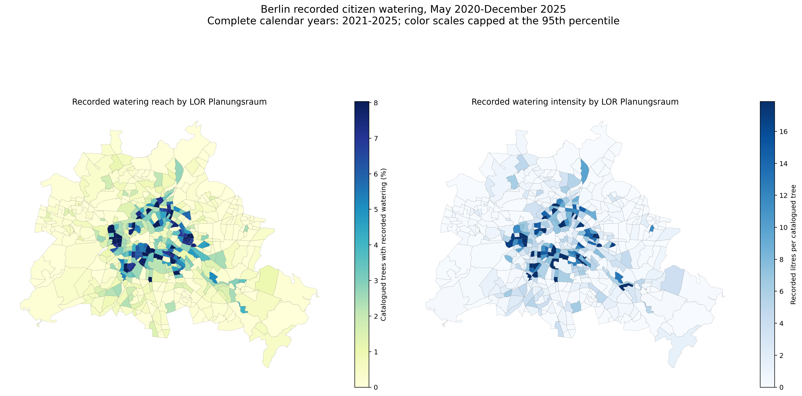

[Original PNG](../../output/spatial/figures/02_lor_watering_reach_intensity.png) · [Data table](../../output/spatial/tables/lor_watering_metrics_2020_2025.csv) · [Builder](../../analysis/build_spatial_notebook.py)

Colour scales are capped at the 95th percentile; inspect the table for extreme values. Recorded platform activity only; current-inventory denominators; no inference about unlogged or municipal watering.

## Plate 03 — Exploratory local spatial clusters

**Period:** May 2020-Dec 2025. **Measure:** Local Moran classes for recorded watering reach.

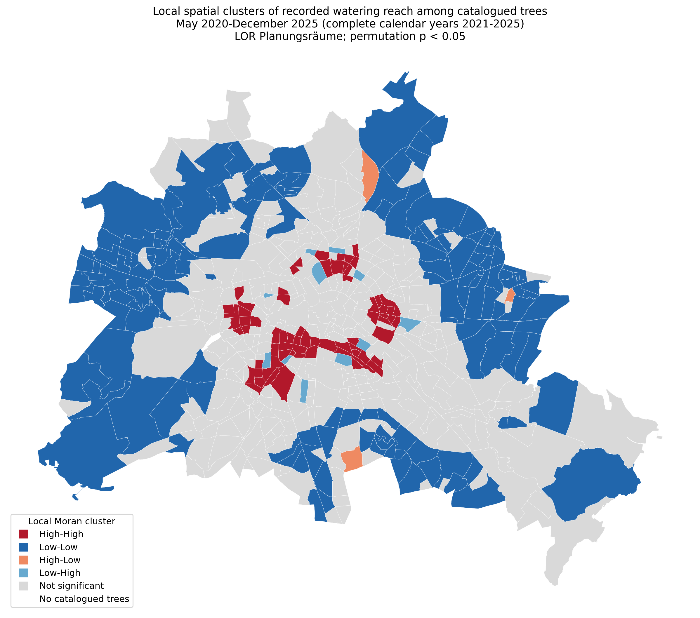

[Original PNG](../../output/spatial/figures/03_lor_local_moran_clusters.png) · [Data table](../../output/spatial/tables/local_moran_watering_clusters.csv) · [Builder](../../analysis/build_spatial_notebook.py)

Row-standardised queen contiguity; 999 permutations; unadjusted local p < 0.05, seed 42. Exploratory screening with no multiplicity correction. Recorded platform activity only; current-inventory denominators; no inference about unlogged or municipal watering.

## Plate 04 — Recorded care and social/environmental context

**Period:** Watering 2020-2025; MSS end-2024; environmental context 2023/24. **Measure:** Recorded reach, MSS status, thermal burden and environmental/social burden count.

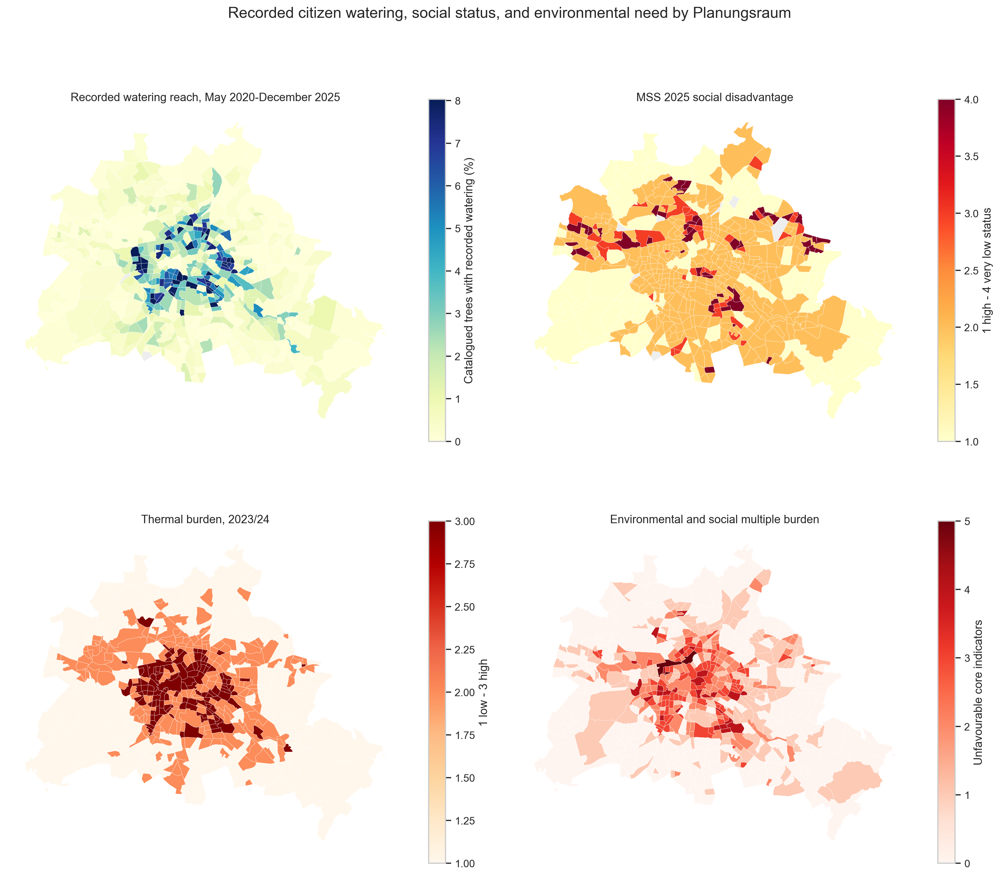

[Original PNG](../../output/equity/figures/01_lor_watering_social_environment.png) · [Data table](../../output/equity/tables/lor_watering_equity_metrics.csv) · [Builder](../../analysis/build_equity_notebook.py)

542 polygons; 535 valid MSS observations with inventoried trees. Static contextual layers are not historical area-level vulnerability. Recorded platform activity only; current-inventory denominators; no inference about unlogged or municipal watering.

## Plate 05 — Areas for further care-gap validation

**Period:** Watering 2020-2025; contextual indicators 2023/24 and end-2024. **Measure:** Low/very-low-status areas with thermal or green need and below-median recorded reach.

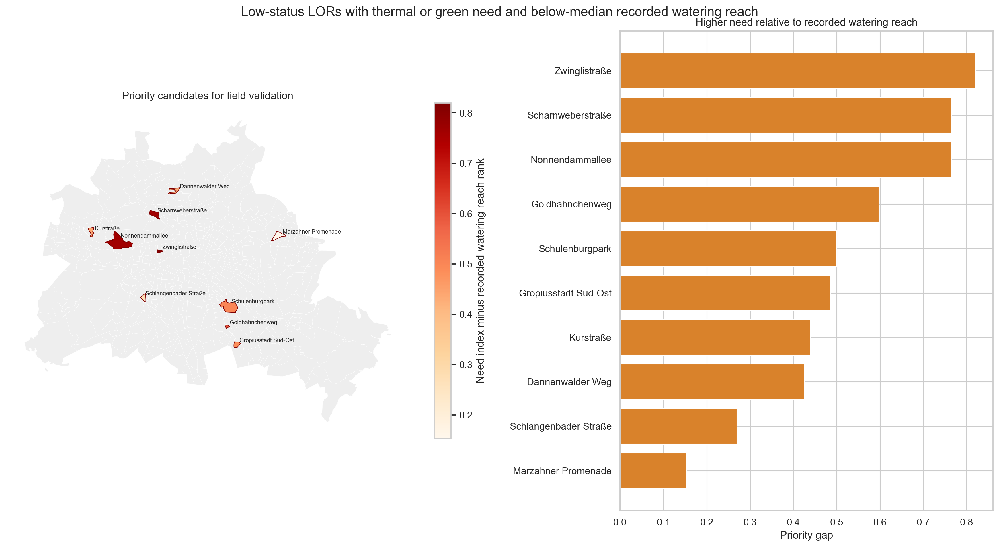

[Original PNG](../../output/equity/figures/03_priority_gap_candidates.png) · [Data table](../../output/equity/tables/priority_gap_planungsraeume.csv) · [Builder](../../analysis/build_equity_notebook.py)

Screening candidates only, not validated irrigation priorities or the proposed allocation model. Recorded platform activity only; current-inventory denominators; no inference about unlogged or municipal watering.

## Plate 06 — Calendar-month climatology

**Period:** Complete years 2021-2025 pooled by calendar month. **Measure:** Mean monthly events per 1,000 current inventory trees.

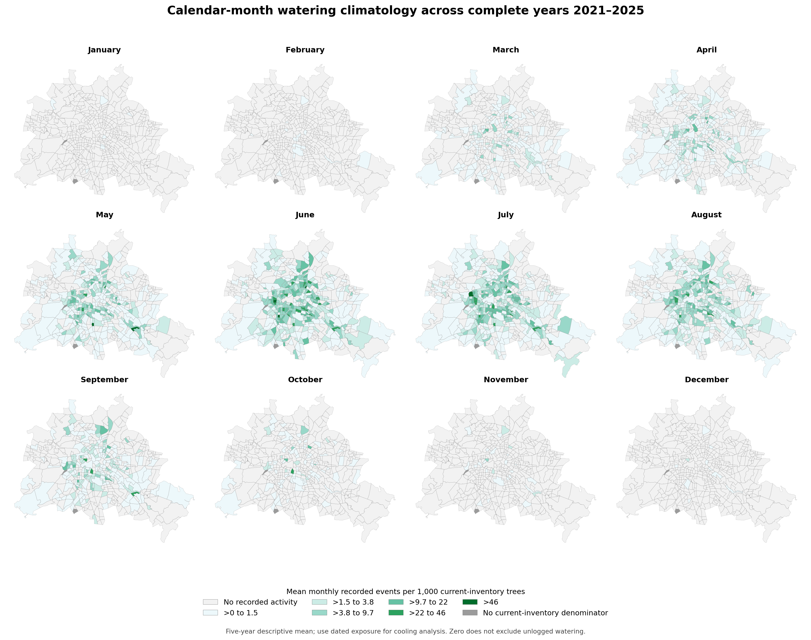

[Original PNG](../../output/03_spatial_equity_vulnerability/maps/01_calendar_month_recorded_watering_atlas.png) · [Data table](../../data/processed/temporal/lor_calendar_month_recorded_watering_2021_2025.csv) · [Builder](../../pipelines/04_build_watering_temporal_atlas.py)

Five-year calendar-month means include observed zeros. Shared fixed classes; no pooled-month thermal inference. Recorded platform activity only; current-inventory denominators; no inference about unlogged or municipal watering.

## Plate 07 — Active-season comparison across years

**Period:** April-September separately in 2021, 2022, 2023, 2024 and 2025. **Measure:** Monthly events per 1,000 current inventory trees.

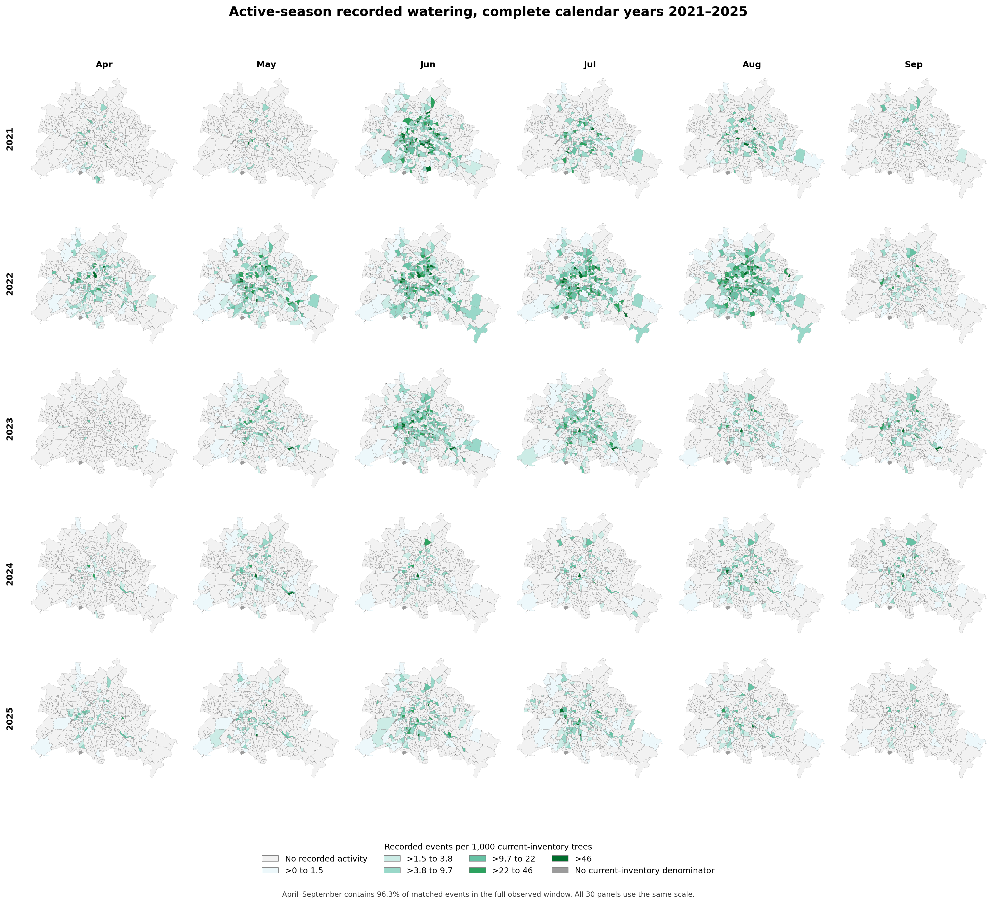

[Original PNG](../../output/03_spatial_equity_vulnerability/maps/02_active_season_recorded_watering_atlas.png) · [Data table](../../data/processed/foundation/lor_month_recorded_watering_2020_2025.csv) · [Builder](../../pipelines/04_build_watering_temporal_atlas.py)

Each panel uses its actual year/month and fixed classes. Recorded platform activity only; current-inventory denominators; no inference about unlogged or municipal watering.

## Plate 08 — 2021 monthly recorded watering

**Period:** January-December 2021. **Measure:** Monthly events per 1,000 current inventory trees.

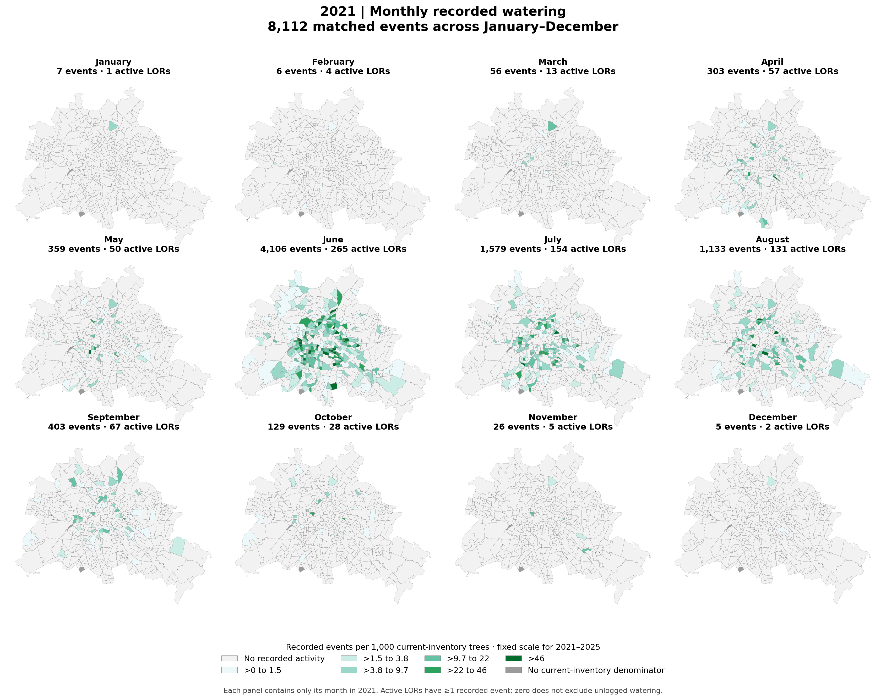

[Original PNG](../../output/03_spatial_equity_vulnerability/maps/yearly/2021_monthly_recorded_watering_atlas.png) · [Data table](../../data/processed/foundation/lor_month_recorded_watering_2020_2025.csv) · [Builder](../../pipelines/04_build_watering_temporal_atlas.py)

Twelve actual months; shared fixed classes across all years. Recorded platform activity only; current-inventory denominators; no inference about unlogged or municipal watering.

## Plate 09 — 2022 monthly recorded watering

**Period:** January-December 2022. **Measure:** Monthly events per 1,000 current inventory trees.

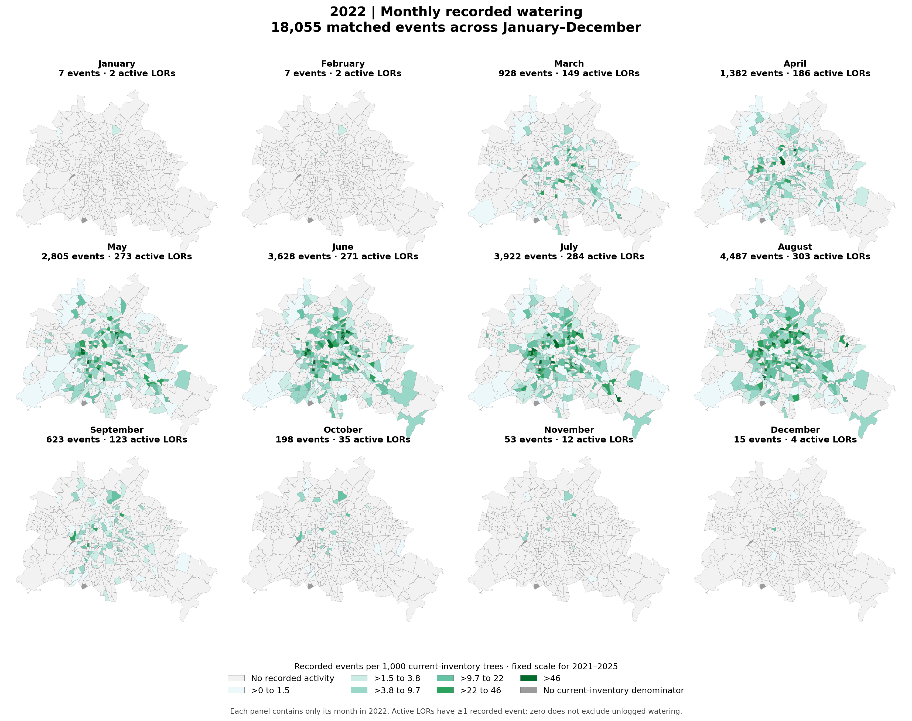

[Original PNG](../../output/03_spatial_equity_vulnerability/maps/yearly/2022_monthly_recorded_watering_atlas.png) · [Data table](../../data/processed/foundation/lor_month_recorded_watering_2020_2025.csv) · [Builder](../../pipelines/04_build_watering_temporal_atlas.py)

Twelve actual months; shared fixed classes across all years. Recorded platform activity only; current-inventory denominators; no inference about unlogged or municipal watering.

## Plate 10 — 2023 monthly recorded watering

**Period:** January-December 2023. **Measure:** Monthly events per 1,000 current inventory trees.

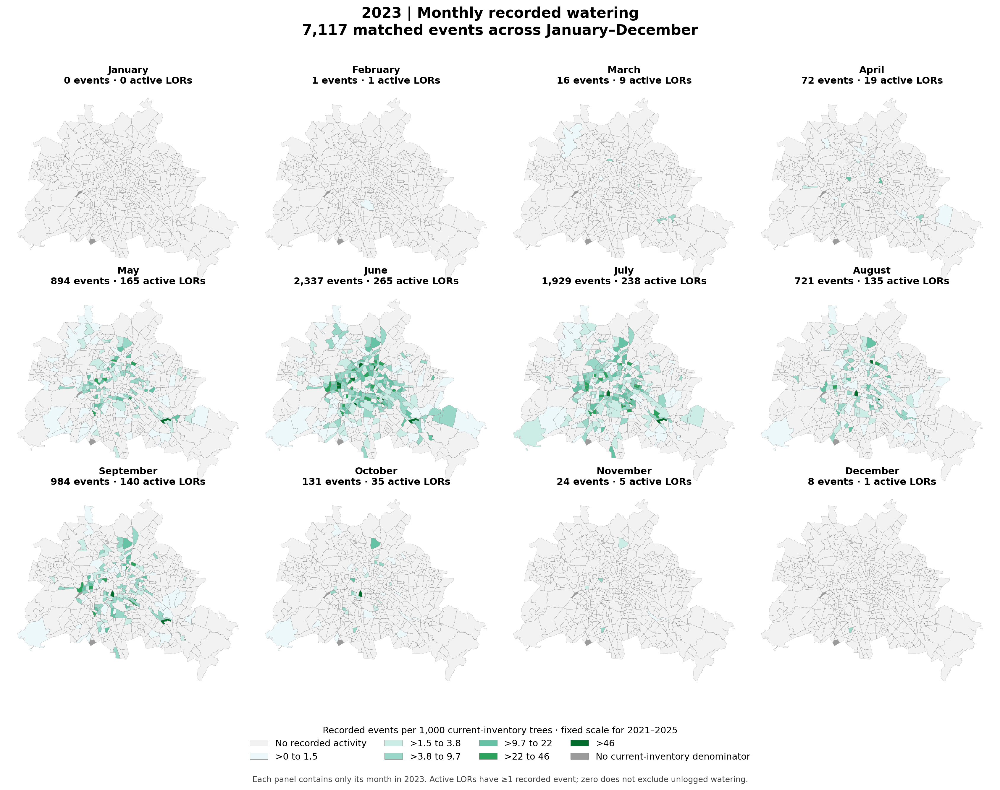

[Original PNG](../../output/03_spatial_equity_vulnerability/maps/yearly/2023_monthly_recorded_watering_atlas.png) · [Data table](../../data/processed/foundation/lor_month_recorded_watering_2020_2025.csv) · [Builder](../../pipelines/04_build_watering_temporal_atlas.py)

Twelve actual months; shared fixed classes across all years. Recorded platform activity only; current-inventory denominators; no inference about unlogged or municipal watering.

## Plate 11 — 2024 monthly recorded watering

**Period:** January-December 2024. **Measure:** Monthly events per 1,000 current inventory trees.

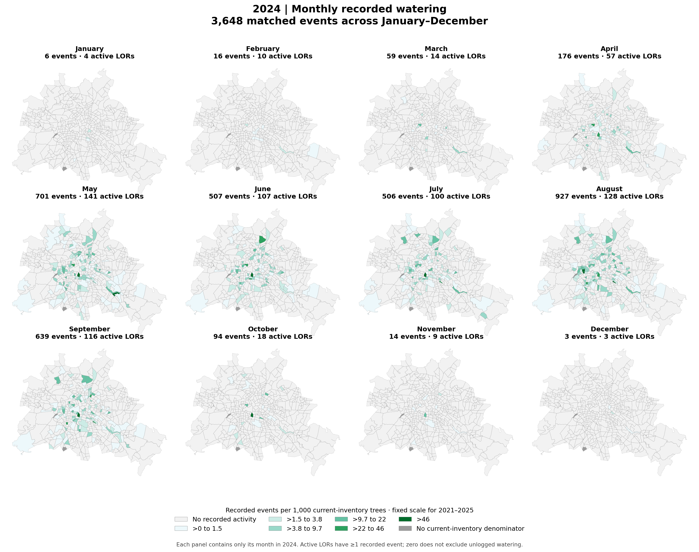

[Original PNG](../../output/03_spatial_equity_vulnerability/maps/yearly/2024_monthly_recorded_watering_atlas.png) · [Data table](../../data/processed/foundation/lor_month_recorded_watering_2020_2025.csv) · [Builder](../../pipelines/04_build_watering_temporal_atlas.py)

Twelve actual months; shared fixed classes across all years. Recorded platform activity only; current-inventory denominators; no inference about unlogged or municipal watering.

## Plate 12 — 2025 monthly recorded watering

**Period:** January-December 2025. **Measure:** Monthly events per 1,000 current inventory trees.

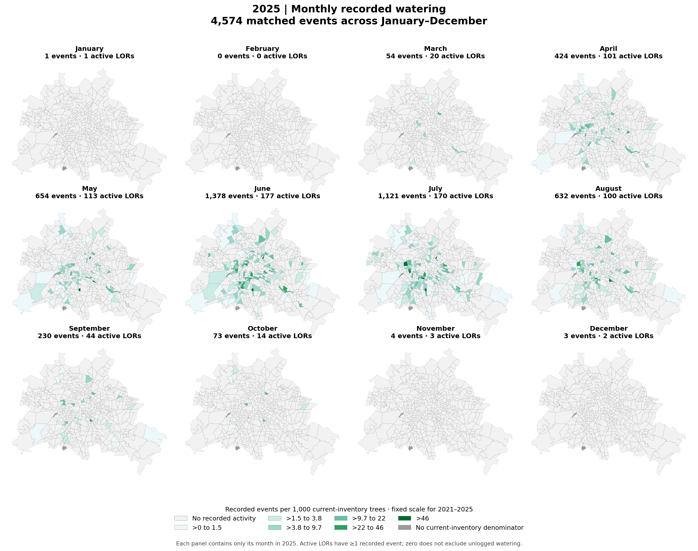

[Original PNG](../../output/03_spatial_equity_vulnerability/maps/yearly/2025_monthly_recorded_watering_atlas.png) · [Data table](../../data/processed/foundation/lor_month_recorded_watering_2020_2025.csv) · [Builder](../../pipelines/04_build_watering_temporal_atlas.py)

Twelve actual months; shared fixed classes across all years. Recorded platform activity only; current-inventory denominators; no inference about unlogged or municipal watering.
