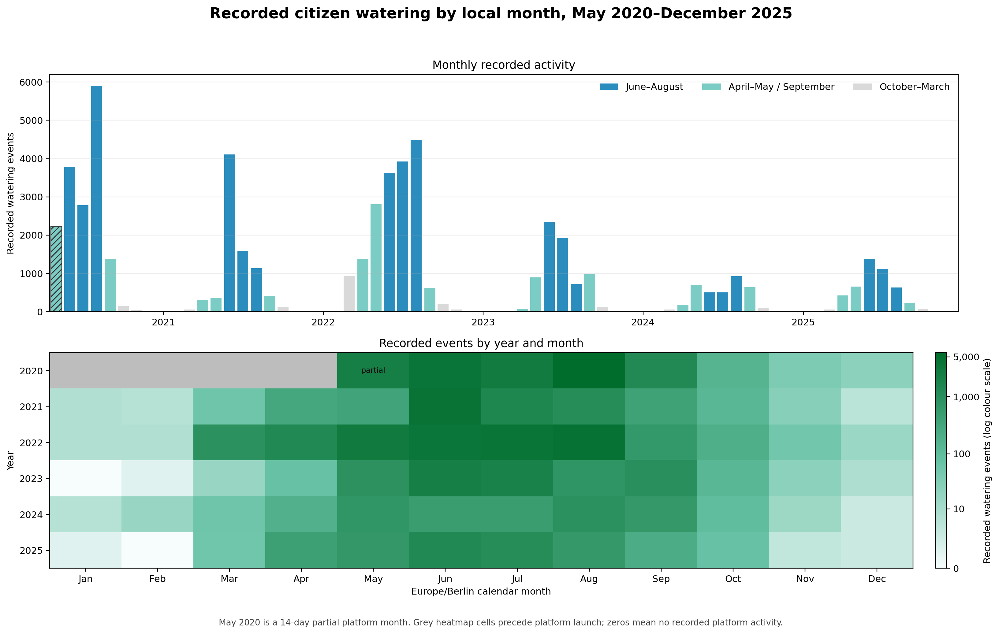
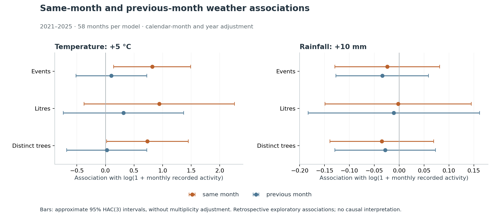

# Preliminary results for seminar examination

Prepared 17 October 2026. These are saved exploratory results, not completed tests of the October proposal's daily response hypotheses.

## Sample reconciliation

| Stage | Events | Distinct trees / interpretation |
| --- | ---: | --- |
| Raw source snapshot, through April 2026 | 58,847 | 11,278 source IDs |
| After removing 111 exact duplicate rows | 58,736 | Full snapshot, including 2026 |
| Study window, May 2020–December 2025 | 58,474 | 2,277,987 recorded litres before geographical linkage |
| Linked to inventory and assigned to a LOR | 57,786 | **11,127 distinct trees; 2,249,502 litres** |
| Unmatched or not LOR-assigned in the study window | 688 | 28,485 litres excluded from the geographical panel |

The full-snapshot inventory match count, **11,160**, is not the study-window LOR count. The October proposal's 11,087 and 11,245 alternatives remain unexplained historical numbers and are not used as the canonical sample. The inventory contains 962,545 rows, 956,347 distinct non-null tree IDs, and 955,434 LOR-assigned IDs. These are different counting units.

The foundation contains **36,856 area-months (542 × 68)**. The positive tree-day table contains **50,259 rows**, with repeat logs on the same tree and local date aggregated. It is not a balanced all-tree/day panel. May 2020 starts on 18 May; complete-calendar-year comparisons use 2021–2025.

Sources: [foundation audit](../data/processed/foundation/lor_month_recorded_watering_2020_2025.metadata.json), [tree-day audit](../data/processed/temporal/recorded_tree_day_watering_2020_2025.metadata.json), [full-snapshot ID match audit](../output/exploratory/tables/tree_id_match_summary.csv), [spatial assignment audit](../output/spatial/tables/spatial_join_audit.csv).

## Findings and what they support

| Finding | Evidence | Interpretation |
| --- | --- | --- |
| Strong seasonal concentration | 71.6% of linked events in June–August; 92.2% in May–September | Motivates an explicit seasonal daily model; pooled maps are descriptive |
| Spatial clustering of reach | Global Moran's I = 0.441; 999-permutation p = 0.001 | Neighbouring areas have related recorded activity; local clusters are exploratory |
| Social and environmental context differ | Child-poverty/reach Spearman rho = -0.123; burden-count/reach rho = 0.486, n = 535 | Recorded care does not follow a simple rich-to-poor gradient; no individual-level inference |
| Same-month temperature association | Event coefficient 0.817 per +5 °C; approximate 95% interval [0.142, 1.492] | Calendar-month/year-adjusted log(1 + events), jointly including rain; not a causal or daily response estimate |
| Previous-month association is imprecise | Event coefficient 0.103; interval [-0.515, 0.722] | Does not rule out responses over shorter periods |
| Care-gap screening is feasible | 10 contextual candidate areas | A validation shortlist, not a completed allocation recommendation |

Evidence tables: [monthly activity](../data/processed/temporal/berlin_month_recorded_watering_2020_2025.csv), [global Moran](../output/spatial/tables/global_moran_watering_reach.csv), [equity associations](../output/equity/tables/equity_associations.csv), [complete monthly model grid](../output/watering_response/tables/monthly_adjusted_associations.csv), [screening candidates](../output/equity/tables/priority_gap_planungsraeume.csv).

## Weather and engagement

The DWD Berlin-Tempelhof series provides shared city-level air-temperature and rainfall context. The main adjusted monthly models use **58 of 60 months in 2021–2025**; June and October 2023 lack complete rainfall observations. Approximate HAC uncertainty uses three calendar lags and preserves gaps. These exploratory intervals are not corrected for multiple comparisons. The coefficients are log(1 + outcome) units, not exact percentages.

2022 has the largest annual event and litre totals, but is not a universal peak: in the comparable June–September windows, 2020 has 13,838 events versus 12,660 in 2022. The 2022 window has more litres. Changing calendar coverage must not be mistaken for changing engagement. [Season comparison table](../output/watering_response/tables/berlin_june_september_comparison.csv).

## Provisional local surface-temperature comparisons

The supplied source has 9,312 rows and 1,811 missing LST values (19.4%). The extension has 6,596 current-Ortsteil months across 97 areas, with **93 areas provisionally eligible** for temperature comparisons. Buckow's duplicate component records cannot be resolved, and the Nikolassee/Zehlendorf/Schlachtensee boundary change is not reconciled to the original extraction.

For April–September 2021–2025, same-month litres/ha has raw Spearman rho +0.299 and area/year-month residual Pearson correlation +0.025 on log(1 + litres/ha). These are different statistics. Next-month residual correlation is −0.024, +0.005 without 2022, and +0.075 using all calendar months. There is no stable descriptive cooling pattern here, and no causal cooling estimate. The report also supplies matched raw Pearson statistics. [Full provisional comparisons](../output/watering_response/ortsteil/tables/provisional_pooled_correlations.csv).

Extraction dates, cloud/compositing rules, source geography, rainfall provenance and `LST_C_count` semantics are unverified. Counts must not be interpreted as satellite scene counts. The extension cannot replace the planned valid-overpass Part I panel. [Source audit](../data/raw/supervisor/README.md).

## Scientific limitations carried into the next stage

- Logs omit municipal, private and unlogged care; selection and recording behaviour can vary across place and time.
- Current inventory denominators may include trees planted after an observation. The proposed historical young-tree offset is not yet built.
- Static end-2024 MSS and 2023/24 environmental indicators do not reconstruct historical vulnerability.
- Most 2024 timestamps and all 2025 timestamps are midnight-rounded in the export; subdaily irrigation timing is unavailable.
- Local Moran p < .05 and the equity associations are exploratory and not multiplicity-adjusted confirmatory evidence.
- Daily civic response, participation explanations, vegetation cooling loss, calibrated allocation and the bridge test remain future work.

See the [October proposal qualifications](proposal/README.md), [map atlas](atlas/README.md), [full response report](../output/watering_response/report.html), and [readiness assessment](readiness.md).
