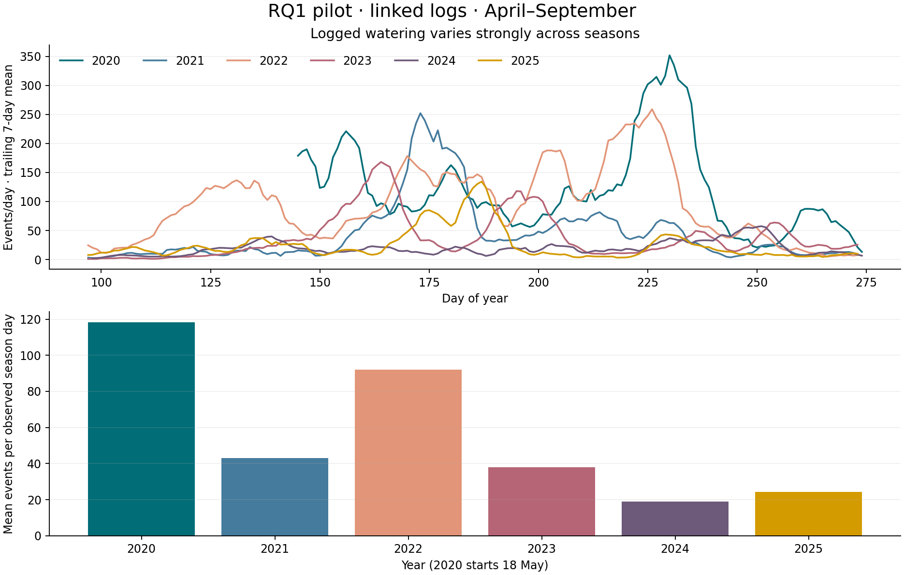
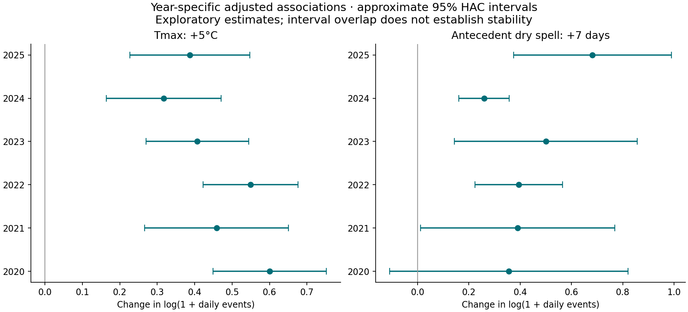

# RQ1: daily civic climate response — initial results

Exploratory pilot · 26 October 2026. Reproduce with `PYTHONPATH=src .venv/bin/python pipelines/08_build_rq1_daily.py`.

## What this analysis establishes

A reconciled daily input panel and adjusted citywide associations for the refined proposal's RQ1. These are linked all-tree logs, not the final street-tree rate sample. The hierarchical negative-binomial and two-part volume models remain to be fitted.

## Sample audit

- 58,847 source rows; 111 exact duplicates removed.
- 58,474 valid positive source logs in the platform window; 57,786 linked events and 2,249,502 linked litres reconcile to the canonical daily product.
- The April–September panel has 1,051 calendar days × 542 planning areas = 569,642 rows.
- 0 days are explicitly unavailable. Without an outage calendar, zeros mean no log in the extract under assumed platform availability.
- Citywide source totals also retain unassigned logs as a coverage sensitivity, not verified Berlin events.
- Dates before 18 May 2020 are absent. 2020 is a partial season. Current inventory is contextual, not a historical risk set.

## Seasonal activity

| Year | Days | Events | Litres | Distinct trees | Events/day | Variance/mean | Zero area-days |
| --- | ---: | ---: | ---: | ---: | ---: | ---: | ---: |
| 2020 | 136 | 16,072 | 479,740 | 4,343 | 118.2 | 91.0 | 93.9% |
| 2021 | 183 | 7,883 | 241,480 | 2,112 | 43.1 | 93.7 | 97.6% |
| 2022 | 183 | 16,847 | 763,651 | 3,912 | 92.1 | 67.2 | 92.3% |
| 2023 | 183 | 6,937 | 380,770 | 2,050 | 37.9 | 51.3 | 96.2% |
| 2024 | 183 | 3,456 | 160,261 | 1,018 | 18.9 | 13.1 | 98.0% |
| 2025 | 183 | 4,439 | 165,365 | 1,349 | 24.3 | 42.8 | 97.7% |

## Calendar-adjusted baseline

OLS outcomes are log(1 + daily total). Controls are year, month, weekday and a common within-month linear trend. All four weather terms enter together. Approximate 95% intervals use 14 actual calendar-day HAC lags. These coefficients are not exact percentage changes in mean counts or litres, and intervals are not multiplicity-adjusted.

| Outcome | Weather increment | Days | Coefficient | Approx. 95% interval |
| --- | --- | ---: | ---: | --- |
| events | Tmax +5°C | 1044 | 0.501 | [0.422, 0.580] |
| events | Today's rain +10 mm | 1044 | -0.340 | [-0.519, -0.161] |
| events | Yesterday's rain +10 mm | 1044 | -0.297 | [-0.424, -0.170] |
| events | Prior dry spell +7 days | 1044 | 0.451 | [0.343, 0.558] |
| litres | Tmax +5°C | 1044 | 0.645 | [0.533, 0.758] |
| litres | Today's rain +10 mm | 1044 | -0.447 | [-0.697, -0.197] |
| litres | Yesterday's rain +10 mm | 1044 | -0.253 | [-0.459, -0.047] |
| litres | Prior dry spell +7 days | 1044 | 0.623 | [0.454, 0.792] |
| distinct_trees | Tmax +5°C | 1044 | 0.495 | [0.417, 0.573] |
| distinct_trees | Today's rain +10 mm | 1044 | -0.332 | [-0.504, -0.160] |
| distinct_trees | Yesterday's rain +10 mm | 1044 | -0.297 | [-0.422, -0.171] |
| distinct_trees | Prior dry spell +7 days | 1044 | 0.449 | [0.344, 0.554] |

## Initial interpretation

The annual temperature coefficients range from 0.317 to 0.600 log1p units per +5°C. 6 of 6 annual estimates are positive. The magnitude varies, so a common direction is not evidence of a constant response.

The event model remains strongly overdispersed in the raw annual summaries, and most area-days have no recorded event. This supports proceeding to the planned hierarchical count model rather than interpreting the citywide baseline as local response estimates.

Selected sensitivity estimates below are prespecified specifications, all reported for the event outcome. Full results for all three outcomes are in the coefficient table.

| Specification | Tmax +5°C | Prior dry spell +7 days |
| --- | --- | --- |
| linked_baseline | 0.501 [0.422, 0.580] | 0.451 [0.343, 0.558] |
| exclude_2020 | 0.477 [0.394, 0.559] | 0.466 [0.354, 0.579] |
| exclude_2022 | 0.493 [0.403, 0.582] | 0.434 [0.304, 0.564] |
| exclude_over_500l | 0.501 [0.422, 0.580] | 0.451 [0.343, 0.558] |
| all_valid_source_logs | 0.501 [0.422, 0.579] | 0.451 [0.344, 0.558] |
| linked_year_month | 0.434 [0.365, 0.502] | 0.394 [0.288, 0.500] |
| early_2020_2022 | 0.567 [0.468, 0.666] | 0.495 [0.382, 0.609] |
| late_2023_2025 | 0.427 [0.324, 0.531] | 0.436 [0.287, 0.586] |

## Temporal stability and sensitivity

The complete grid in [model_coefficients.csv](tables/model_coefficients.csv) includes annual and early/late fits, removal of 2020 or 2022, exclusion of >500 L logs, source-coverage sensitivity, HAC bandwidths, year-by-month controls, quadratic temperature and antecedent rain. Annual fits describe heterogeneity; they do not establish stability or formally compare slopes. Quadratic temperature makes the linear term a slope at 20°C; read both terms together.

## Limits and next analysis

1. Treat weather associations as descriptive. Day-level logging dates need not be actual watering dates. Most 2024 and all 2025 source timestamps are UTC midnight; hourly comparisons are unsupported.
2. Verify platform availability and match street-tree logs to a street-tree stock. Include never-active eligible areas; flag their partially pooled slopes as weakly identified. Inventory age alone does not identify municipal care.
3. Add documented holiday, campaign and participation covariates; specify nonlinear terms and formal annual contrasts before fitting the hierarchical count and two-part volume models.
4. Validate across held-out seasons and spatial blocks. All 2020–2025 seasons have now been inspected; future validation on these seasons is retrospective, not an untouched confirmatory test.
5. Weather comes from one station. Missing rainfall propagates into lag/dryness features; it is not filled with zero. A dry spell is a meteorological proxy, not measured tree water stress.

See [protocol](../../docs/rq1_daily_exploratory_protocol.md), [annual audit](tables/annual_summary.csv), [fit inclusion audit](model_audit.json), and [source checksums](metadata.json).
